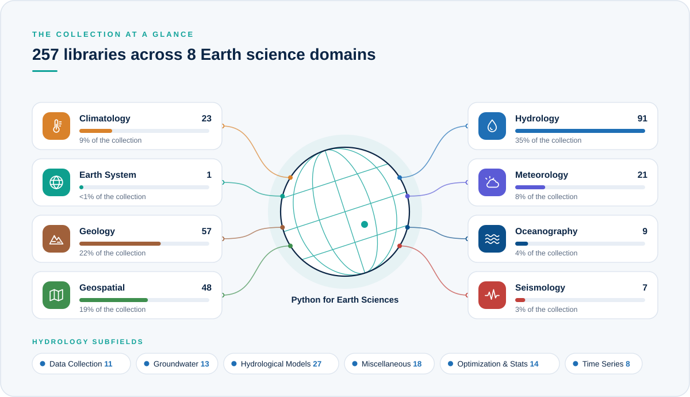

<a id="top"></a>

<p align="center">
  
</p>

<p align="center">
  <b>A curated directory of open-source Python libraries for hydrology, meteorology, climatology,<br>geology, oceanography, seismology and geospatial science.</b>
</p>

<p align="center">
  <a href="https://github.com/javedali99/python-resources-for-earth-sciences/stargazers"></a>
  <a href="https://github.com/javedali99/python-resources-for-earth-sciences/network/members"></a>
  <a href="#contributing"></a>
  <a href="LICENSE"></a>
</p>

<!-- AUTO:stats:START -->
<p align="center">
  
  
  
  <a href="https://github.com/javedali99/python-resources-for-earth-sciences/commits"></a>
</p>
<!-- AUTO:stats:END -->

<p align="center">
  <a href="#about"><b>About</b></a> &nbsp;·&nbsp;
  <a href="#browse"><b>Browse domains</b></a> &nbsp;·&nbsp;
  <a href="#at-a-glance"><b>At a glance</b></a> &nbsp;·&nbsp;
  <a href="#contributing"><b>Contribute</b></a> &nbsp;·&nbsp;
  <a href="https://github.com/javedali99/python-resources-for-earth-sciences/issues/new"><b>Suggest a library</b></a>
</p>

<br>

<a id="about"></a>

##  About

**Python Resources for Earth Sciences** is a curated directory of open-source Python libraries for observing, modelling and understanding the Earth. It gathers tools for water, weather, climate, rocks, oceans, earthquakes and maps in one place, so you spend less time searching for the right package and more time doing science.

<p align="center">
  
</p>

<table>
  <tr>
    <td width="33%" valign="top">
      <h4>Who it's for</h4>
      Researchers, students, engineers and data scientists who work with Earth and environmental data in Python.
    </td>
    <td width="33%" valign="top">
      <h4>How it's organised</h4>
      Libraries are grouped by domain, and Hydrology is split into subfields. Domains, subfields and libraries are all listed A to Z.
    </td>
    <td width="33%" valign="top">
      <h4>Good to know</h4>
      Many tools serve several domains, so each is listed where it is most often used. Every name links to the project's docs or source code.
    </td>
  </tr>
</table>

> [!TIP]
> Know a library that belongs here? Open an [issue](https://github.com/javedali99/python-resources-for-earth-sciences/issues/new) or a [pull request](https://github.com/javedali99/python-resources-for-earth-sciences/pulls), or [send me an email](mailto:javedali28@gmail.com). If this list helps your work, a ⭐ helps others find it.

<br>

<a id="browse"></a>

##  Browse by Domain

<!-- AUTO:grid:START -->
<table>
  <tr>
    <td align="center" width="25%" valign="top">
      <a href="#climatology"></a><br>
      <a href="#climatology"><b>Climatology</b></a><br>
      
    </td>
    <td align="center" width="25%" valign="top">
      <a href="#earth-system-science"></a><br>
      <a href="#earth-system-science"><b>Earth System Science</b></a><br>
      
    </td>
    <td align="center" width="25%" valign="top">
      <a href="#geology"></a><br>
      <a href="#geology"><b>Geology</b></a><br>
      
    </td>
    <td align="center" width="25%" valign="top">
      <a href="#geospatial-analysis-and-mapping"></a><br>
      <a href="#geospatial-analysis-and-mapping"><b>Geospatial Analysis and Mapping</b></a><br>
      
    </td>
  </tr>
  <tr>
    <td align="center" width="25%" valign="top">
      <a href="#hydrology"></a><br>
      <a href="#hydrology"><b>Hydrology</b></a><br>
      
    </td>
    <td align="center" width="25%" valign="top">
      <a href="#meteorology"></a><br>
      <a href="#meteorology"><b>Meteorology</b></a><br>
      
    </td>
    <td align="center" width="25%" valign="top">
      <a href="#oceanography"></a><br>
      <a href="#oceanography"><b>Oceanography</b></a><br>
      
    </td>
    <td align="center" width="25%" valign="top">
      <a href="#seismology"></a><br>
      <a href="#seismology"><b>Seismology</b></a><br>
      
    </td>
  </tr>
</table>
<!-- AUTO:grid:END -->

<!-- AUTO:toc:START -->
<details>
<summary><b>Full table of contents</b></summary>
<br>

- [Climatology](#climatology) <sub>23 libraries</sub>
- [Earth System Science](#earth-system-science) <sub>1 library</sub>
- [Geology](#geology) <sub>57 libraries</sub>
- [Geospatial Analysis and Mapping](#geospatial-analysis-and-mapping) <sub>48 libraries</sub>
- [Hydrology](#hydrology) <sub>91 libraries</sub>
  - [Data Collection](#data-collection) <sub>11 libraries</sub>
  - [Groundwater Modelling](#groundwater-modelling) <sub>13 libraries</sub>
  - [Hydrological Modelling](#hydrological-modelling) <sub>27 libraries</sub>
  - [Miscellaneous](#miscellaneous) <sub>18 libraries</sub>
  - [Optimization, Uncertainty, Statistics](#optimization-uncertainty-statistics) <sub>14 libraries</sub>
  - [Time Series Analysis](#time-series-analysis) <sub>8 libraries</sub>
- [Meteorology](#meteorology) <sub>21 libraries</sub>
- [Oceanography](#oceanography) <sub>9 libraries</sub>
- [Seismology](#seismology) <sub>7 libraries</sub>

</details>
<!-- AUTO:toc:END -->

<br>

<a id="at-a-glance"></a>

##  The Collection at a Glance

<p align="center">
  
</p>

<br>

---

<!-- LIBRARIES:START -->
<a id="climatology"></a>

##  Climatology

<!-- AUTO:count:climatology:START -->

<!-- AUTO:count:climatology:END -->

> Climate modelling, diagnostics, indices, gridded data analysis and prediction tools.

| Library | Description |
|:--|:--|
| **[aospy](https://aospy.readthedocs.io/en/stable/)** | Automated analysis and management of gridded climate data. |
| **[CINEI](https://github.com/Luyikeka/cinei)** | Integrates global and regional anthropogenic emission inventories (CEDS, EDGAR, HTAP, MEIC) into sector-resolved, model-ready gridded NetCDF with consistent NMVOC speciation for atmospheric chemistry and air-quality models. |
| **[climada-python](https://github.com/CLIMADA-project/climada_python)** | CLIMADA stands for CLIMate ADAptation and is a probabilistic natural catastrophe impact model, that also calculates averted damage (benefit) thanks to adaptation measures of any kind (from grey to green infrastructure, behavioural, etc.). |
| **[climate-indices](https://climate-indices.readthedocs.io/en/latest/)** | Various climate index algorithms relating to precipitation and temperature. |
| **[climlab](https://climlab.readthedocs.io/en/latest/)** | Process-oriented climate modeling. |
| **[climmetlab](https://climetlab.readthedocs.io/en/latest/)** | Python package aiming at simplifying access to climate and meteorological datasets. |
| **[climpred](https://climpred.readthedocs.io/)** | `climpred` aims to be the primary package used to analyze output from initialized dynamical forecast models, ranging from short-term weather forecasts to decadal climate forecasts. |
| **[climt](https://climt.readthedocs.io/en/latest/)** | Climate modelling and diagnostics toolkit. |
| **[climtas](https://climtas.readthedocs.io/en/latest/)** | Climtas is a package for working with large climate analyses. It focuses on the time domain with custom functions for Xarray and Dask data. |
| **[ESMvaltool](https://www.esmvaltool.org)** | Community diagnostic and performance metrics tool for routine evaluation of Earth system models in CMIP. |
| **[nctoolkit](https://nctoolkit.readthedocs.io/en/latest/)** | The Python package nctoolkit provides fast and easy analysis of netCDF data, with a focus on the analysis and post-processing of climate and ocean model data. |
| **[Oocgcm](https://oocgcm.readthedocs.io/en/latest/)** | Analysis of large gridded geophysical datasets. |
| **[OpenClimateGIS](https://www.earthsystemcog.org/projects/openclimategis/)** | Geospatial manipulation, subsetting, computation, and translation of spatiotemporal climate data. |
| **[Pangaea](https://pangaea.readthedocs.io/en/latest/)** | xarray extension for gridded land surface & weather model output. |
| **[PyCLES](https://github.com/pressel/pycles)** | Atmospheric large eddy simulation infrastructure designed to simulate boundary layer clouds and deep convection. |
| **[pycpt](https://bitbucket.org/py-iri/iri-pycpt/src/master/)** | Climate Predictability Tool, supports model output statistics (MOS), Conanical Correlation Analysis (CCA) and principal components regression (PCR), + access to many subseasonal-to-seasonal ensemble predictions (e.g., the NMME, C3S, SubX databases). |
| **[pyOWM](https://github.com/csparpa/pyowm)** | PyOWM is a client Python wrapper library for OpenWeatherMap (OWM) web APIs. |
| **[pyrcel](https://github.com/darothen/pyrcel)** | Adiabatic cloud parcel model for studying aerosol activation. |
| **[ROCK-PCA](https://github.com/DiegoBueso/ROCK-PCA)** | ROtated Complex Kernel PCA for spatio-temporal analysis of earth observation data. |
| **[wrf-python](https://wrf-python.readthedocs.io/en/latest/)** | A collection of diagnostic and interpolation routines for use with output from the Weather Research and Forecasting (WRF-ARW) Model. |
| **[xeof](https://github.com/nicrie/xeofs)** | Python library supporting rotated/multivariate EOF analysis. |
| **[xgcm](https://xgcm.readthedocs.io/en/latest/)** | Extends the xarray data model to understand finite volume grid cells (common in General Circulation Models) and provides interpolation and difference operations for such grids. |
| **[xMCA](https://pyxmca.readthedocs.io/en/latest/index.html)** | Python library for (rotated) Principal Component and Maximum Covariance Analysis. |

<p align="right"><a href="#top"><sub>Back to top ↑</sub></a></p>

---

<a id="earth-system-science"></a>

##  Earth System Science

<!-- AUTO:count:earth-system-science:START -->

<!-- AUTO:count:earth-system-science:END -->

> Box models and frameworks that couple processes across the Earth system.

| Library | Description |
|:--|:--|
| **[ESBMTK](https://esbmtk.readthedocs.io/en/latest)** | The Earth Sciences Box Modeling Toolkit (ESBMTK) is a Python library that aims to simplify typical box modeling projects in the Earth-Sciences. It uses a declarative approach to describe models, and abstracts typical modeling tasks like gas exchange and carbonate dissolution through Python classes. See the manual at https://esbmtk.readthedocs.io/en/latest for installation instructions usage, and example code. |

<p align="right"><a href="#top"><sub>Back to top ↑</sub></a></p>

---

<a id="geology"></a>

##  Geology

<!-- AUTO:count:geology:START -->

<!-- AUTO:count:geology:END -->

> Structural geology, geochemistry, geophysics, petrophysics and landscape evolution.

| Library | Description |
|:--|:--|
| **[APSG](https://apsg.readthedocs.io)** | APSG defines several new Python classes to easily manage, analyze, and visualize orientational structural geology data. |
| **[ArcGIS API for Python](https://developers.arcgis.com/python)** | ArcGIS API for Python is a powerful Python library for mapping, spatial analysis, data science, geospatial AI and automation. |
| **[Badlands](https://badlands.readthedocs.io)** | Badlands is an open-source Python-based code that can be used to simulate Basin and Landscape Dynamics. |
| **[BERT](http://resistivity.net/bert)** | Boundless Electrical Resistivity Tomography (BERT) is a software package for modelling and inversion of ERT data. It has originally been programmed as C++ apps based on the pyGIMLi core library, plus bash scripts for command line, but is increasingly using Python through pyGIMLi and pybert, not only for visualization but also for computing. |
| **[cbsyst](https://github.com/oscarbranson/cbsyst)** | cbsyst is a Python module for calculating seawater carbon and boron chemistry. |
| **[cf-python](https://github.com/NCAS-CMS/cf-python)** | The Python cf package is an Earth Science data analysis library that is built on a complete implementation of the CF data model. |
| **[DensityX](https://github.com/kaylai/DensityX)** | DensityX is a Python script that takes an excel spreadsheet containing major oxide data, T, and P for a silicate melt and outputs the density of each sample as a new excel spreadsheet. |
| **[detritalPy](https://github.com/grsharman/detritalPy)** | detritalPy is a Python module for visualizing and analyzing detrital geo-thermochronologic data. |
| **[Devito](http://www.devitoproject.org)** | Devito is a Python package to implement optimized stencil computation (e.g., finite differences, image processing, machine learning) from high-level symbolic problem definitions. Devito builds on SymPy and uses automated code generation and just-in-time compilation to execute optimized computational kernels on several computer platforms, including CPUs, GPUs, and clusters thereof. |
| **[diffusion_chronometry](https://github.com/jlubbersgeo/diffusion_chronometry)** | diffusion_chronometry is a repository by <a href="https://twitter.com/caldera_curator">Jordan Lubbers</a> for all things pertaining to the modelling of diffusive equilibration of trace elements in minerals. Rather than build a bunch of fancy functions, the Jupyter notebooks are built "from scratch" so as to be transparent with as much of the building of the model as possible. |
| **[EQcorrscan](https://github.com/eqcorrscan/EQcorrscan)** | EQcorrscan is a Python package for the detection and analysis of repeating and near-repeating seismicity. |
| **[Fastscape](https://github.com/fastscape-lem/fastscape)** | Fastscape is a Python package that provides a lot a small model components (i.e., processes) to use with the xarray-simlab modeling framework. Those components can readily be combined together in order to create custom Landscape Evolution Models (LEMs). |
| **[Fatiando a Terra](https://www.fatiando.org)** | Fatiando a Terra develops and maintains Python packages for Geophysics data processing, modeling like VERDE (Spatial data processing and interpolation using Green's functions), harmonica (processing and modeling gravity and magnetic data), and Boule (Reference ellipsoids for geodesy and geophysics). |
| **[FloPy](https://github.com/modflowpy/flopy)** | FloPy is a Python package for creating, running, and post-processing MODFLOW-Based models. |
| **[GemGIS](https://github.com/cgre-aachen/gemgis)** | The aim of GemGIS is to become a bridge between conventional geoinformation systems (GIS) such as ArcGIS and QGIS, and geomodeling tools such as GemPy, allowing simpler and more automated workflows from one environment to the other. |
| **[GemPy](https://www.gempy.org)** | GemPy is a tool for generating three-dimensional structural geological models in Python. It allows the user to create complex combinations of stratigraphical and structural features such as folds, faults, and unconformities. It was furthermore designed to enable probabilistic modeling to address parameter and model uncertainties. |
| **[GeostatsPy](https://github.com/GeostatsGuy/GeostatsPy)** | GeostatsPy brings GSLIB: Geostatistical Library functions to Python. GSLIB is a practical and extremely robust set of code for building spatial modeling workflows. |
| **[gprMax](https://www.gprmax.com)** | gprMax is open-source software that simulates electromagnetic wave propagation. It solves Maxwell’s equations in three dimensions by using the finite-difference time-domain method. gprMax was designed for modeling ground-penetrating radar but can also be used to model electromagnetic wave propagation for many other applications. |
| **[HyVR](https://github.com/driftingtides/hyvr)** | The Hydrogeological Virtual Reality simulation package (HyVR) is a Python module that helps researchers and practitioners generate subsurface models with multiple scales of heterogeneity that are based on geological concepts. The simulation outputs can then be used to explore groundwater flow and solute transport behavior. This is facilitated by HyVR outputs in the input formats of common flow simulation packages. Given that each site is unique, HyVR has been designed for users to take the code and extend it to suit their particular simulation needs. |
| **[Invert4Geom](https://invert4geom.readthedocs.io/en/latest/)** | `Invert4Geom` is an open-source library for performing 3D geometric (structural) gravity inversions. While there are great existing tools for performing gravity inversions for subsurface density (e.g. PyGIMLi, SimPEG) there are few, if any, open-source software for inverting for geometry. This is useful for modelling the Moho, the sediment-basement contact, or bathymetry. |
| **[LakePy](https://github.com/ESIPFed/LakePy)** | LakePy is the pythonic user-centered front-end to the Global Lake Level Database. This package can instantly deliver lake water levels for some 2000+ lakes scattered across the globe. |
| **[Landlab](https://github.com/landlab/landlab)** | Landlab is an open-source Python package for numerical modeling of Earth surface dynamics. It contains (1) a gridding engine that represents the model domain and that supports regular and irregular grids; (2) a library of process components, each of which represents a physical process (e.g., generation of rain, erosion by flowing water); (3) utilities that support general numerical methods, file input and output, and visualization. In addition Landlab contains a set of Jupyter notebook tutorials that introduce core concepts and give examples of use. |
| **[Lasio](https://github.com/kinverarity1/lasio)** | Lasio is a Python package to read and write Log ASCII Standard (LAS) files, which are used for borehole data such as geophysical, geological, or petrophysical logs. It is compatible with versions 1.2 and 2.0 of the LAS file specification, published by the Canadian Well Logging Society. Support for LAS 3 is ongoing. In principle, it is designed to read as many types of LAS files as possible, including those containing common errors or non-compliant formatting. Sometimes we want a higher-level object, for example, to contain methods that have nothing to do with LAS files. We may want to handle other well data, such as deviation surveys, tops (aka picks), engineering data, striplogs, synthetics, and so on. This is where welly comes in. |
| **[latools](https://latools.readthedocs.io)** | Laser Ablation Tools (latools) is a Python toolbox for processing Laser Ablations Mass Spectrometry (LA-MS) data. |
| **[litholog](https://litholog.readthedocs.io)** | litholog is focused on providing a framework to digitize, store, plot, and analyze sedimentary graphic logs. |
| **[Loop](https://loop3d.github.io)** | Loop is an open source 3D probabilistic geological and geophysical modelling platform, initiated by Geoscience Australia and the OneGeology consortium. The project is funded by Australian territory, State and Federal Geological Surveys, the Australian Research Council and the MinEx Collaborative Research Centre. It includes the Loopstructural and map2loop packages, minded for 3d geological modelling. |
| **[LSDTopoTools](https://lsdtopotools.github.io)** | LSDTopoTools is a software package for analysing topography. Applications of these analyses span hydrology, geomorphology, soil science, ecology, and cognate fields. The serious number crunching in LSDTopoTools is done in C++ code, but the output needs to be visualised with either a GIS or python. |
| **[MIMiC](https://github.com/DJRgeoscience/MIMiC)** | Melt inclusion modification corrections (MIMiC) is a program corrects melt inclusions for post-entrapment crystallization/melting (PEC/PEM) with optional corrections for Fe-Mg exchange with the host and vapor bubble growth. |
| **[MintPy](https://github.com/insarlab/MintPy)** | The Miami INsar Time-series software in PYthon (MintPy) is an open-source package for Interferometric Synthetic Aperture Radar (InSAR) time series analysis. |
| **[MSNoise](https://github.com/ROBelgium/MSNoise)** | MSNoise is the first complete software package for computing and monitoring relative velocity variations using ambient seismic noise. MSNoise is a fully-integrated solution that automatically scans data archives and determines which jobs need to be done whenever the scheduled task is executed. |
| **[MTpy](https://github.com/MTgeophysics/mtpy)** | MTpy is a Python Toolbox for Magnetotelluric (MT) Data Processing, Analysis, Modelling and Visualization. |
| **[PetroPy](https://github.com/toddheitmann/PetroPy)** | PetroPy is a python petrophysics package allowing scientific Python computing of conventional and unconventional formation evaluation. It uses lasio to read las files and includes a petrophysical workflow and a log viewer based on XML templates. |
| **[PmagPy](https://github.com/PmagPy)** | The PmagPy project is a set of tools written in Python for the analysis of paleomagnetic data. |
| **[PVGeo](https://pvgeo.org)** | PVGeo is an open-source Python package for geoscientific visualization and analysis harnessing an already powerful software platform: the Visualization Toolkit (VTK) and its front-end application, ParaView. |
| **[PyDGS](https://github.com/dbuscombe-usgs/pyDGS)** | PyDGS is an open-source project dedicated to provide a Python framework to compute estimates of grain size distribution using the continuous wavelet transform method. |
| **[PyFLOWGO](https://github.com/pyflowgo/pyflowgo)** | PyFLOWGO is an open-source platform for simulation of channelized lava thermo-rheological properties. |
| **[pyGeoPressure](https://github.com/whimian/pyGeoPressure)** | pyGeoPressure is an open-source Python package designed for pore-pressure prediction from both well log data and seismic velocity data. Though light weight, pyGeoPressure performs the entire workflow, from data management to pressure prediction. The main features of pyGeoPressure are (1) it makes overburden (or lithostatic) pressure calculations; 2) it uses Eaton’s method and parameter optimization; 3) it uses Bowers’ method and parameter optimization; and (4) it implements a multivariate method with parameter optimization. |
| **[pyGIMLi](https://www.pygimli.org)** | pyGIMLi is an open-source library for modeling and inversion and in geophysics. The object-oriented library provides management for structured and unstructured meshes in two and three dimensions, finite-element and finite-volume solvers, various geophysical forward operators, as well as Gauss-Newton--based frameworks for constrained, joint, and fully coupled inversions with flexible regularization. |
| **[PyGMT](https://www.pygmt.org)** | PyGMT is a Python wrapper for the Generic Mapping Tools (GMT), a command-line program widely used in the Earth Sciences. It provides capabilities for processing spatial data (gridding, filtering, masking, FFTs, etc) and making high quality plots and maps. |
| **[Pyleoclim](https://pyleoclim-util.readthedocs.io)** | Pyleoclim is a Python package designed for the analysis of paleoclimate data. Pyleoclim leverages various data science libraries (numpy, pandas, scikit-learn) for time series analysis, as well as and Matplotlib and Cartopy for the creation of publication-quality figures. |
| **[Pyrocko](https://git.pyrocko.org/pyrocko/pyrocko)** | Pyrocko is an open source seismology toolbox and library. Most of Pyrocko is coded in the Python programming language, with a few parts coded in C. |
| **[pyrolite](https://pyrolite.readthedocs.io/en/master)** | pyrolite is a set of tools to handle and visualize geochemical data. The Python package includes functions to work with compositional data and to transform geochemical variables (e.g., elements to oxides), functions for common plotting tasks (e.g., spiderplots, ternary diagrams, bivariate and ternary density diagrams), and numerous auxiliary utilities. |
| **[PySAT](https://github.com/pysathq/pysat)** | PySAT is a Python toolkit, which aims at providing a simple and unified interface to a number of state-of-art Boolean satisfiability (SAT) solvers as well as to a variety of cardinality and pseudo-Boolean encodings. |
| **[PyVista](https://docs.pyvista.org)** | PyVista (formerly vtki) is a helper module for the Visualization Toolkit (VTK) that takes a different approach on interfacing with VTK through NumPy and direct array access. This package provides a Pythonic, well-documented interface exposing VTK’s powerful visualization backend to facilitate rapid prototyping, analysis, and visual integration of spatially referenced datasets. |
| **[PyWEED](https://github.com/iris-edu/pyweed)** | PyWEED is an application for retrieving event-based seismic data. |
| **[QuakeMigrate](https://github.com/QuakeMigrate/QuakeMigrate)** | QuakeMigrate is a Python package for automatic earthquake detection and location using waveform migration and stacking. It can be used to produce catalogues of earthquakes, including hypocentres, origin times, phase arrival picks, and local magnitude estimates, as well as rigorous estimates of the associated uncertainties. |
| **[REDPy](https://github.com/ahotovec/REDPy)** | Repeating Earthquake Detector in Python (REDPy) is a tool for automated detection and analysis of repeating earthquakes in continuous data. It works without any previous assumptions of what repeating seismicity looks like (that is, does not require a template event). |
| **[RfPy](https://github.com/paudetseis/RfPy)** | RfPy is a software to calculate single event-station receiver functions from the spectral deconvolution technique. |
| **[SediNet](https://github.com/MARDAScience/SediNet)** | SediNet configurable machine-learning framework for estimating either (or both) continuous and categorical variables from a photographic image of clastic sediment. |
| **[Segyio](https://github.com/equinor/segyio)** | Segyio is a small LGPL licensed C library for easy interaction with SEG-Y and Seismic Unix formatted seismic data, with language bindings for Python and Matlab. Segyio is an attempt to create an easy-to-use, embeddable, community-oriented library for seismic applications. Features are added as they are needed; suggestions and contributions of all kinds are very welcome. |
| **[SHTOOLS](https://github.com/SHTOOLS/SHTOOLS)** | SHTOOLS is a Fortran-95/Python library that can be used to perform spherical harmonic transforms, multitaper spectral analyses, expansions of functions into Slepian bases, and standard operations on global gravitational and magnetic field data. |
| **[SimPEG](https://github.com/simpeg/simpeg)** | Simulation and Parameter Estimation in Geophysics (SimPEG) is a python package for simulation and gradient-based parameter estimation in the context of geophysical applications. |
| **[SplitPy](https://paudetseis.github.io/SplitPy)** | SplitPy is a teleseismic shear-wave (SKS) Splitting Toolbox based on the Matlab Tool SplitLab, developed by Wustefeld et al (2008). |
| **[tdmtpy](https://github.com/LLNL/mttime)** | Time Domain Moment Tensor Inversion in Python (tdmtpy) is a python package developed for time domain inversion of complete seismic waveform data to obtain the seismic moment tensor. It supports deviatoric and full moment tensor inversions, and 1-D and 3-D basis Green's functions. |
| **[Thermobar](https://github.com/PennyWieser/Thermobar)** | Thermobar is a Mineral-Melt Equilibrium tool written in the open-source language Python3. Thermobar allows pressures, temperatures and melt water contents to be easily calculated using more than 100 popular thermobarometers. We also provide computationally-fast functions for calculating pressures and temperatures for all possible pairs of phases in equilibrium from a given sample/volcanic center (e.g., cpx-liquid, opx-liquid, two-pyroxene, two-feldspar matching). |
| **[VESIcal](https://github.com/kaylai/VESIcal)** | VESIcal is a generalized python library for calculating and plotting various things related to mixed volatile (H<sub>2</sub>O-CO<sub>2</sub>) solubility in silicate melts. |
| **[Welly](https://github.com/agile-geoscience/welly)** | Welly uses lasio for data input and output but hides much of it from the user. I recommend that you look at both projects before deciding if you need the "well-level" functionality that welly provides. Welly is a family of classes to facilitate the loading, processing, and analysis of subsurface wells and well data, such as striplogs, formation tops, well log curves, and synthetic seismograms. |

<p align="right"><a href="#top"><sub>Back to top ↑</sub></a></p>

---

<a id="geospatial-analysis-and-mapping"></a>

##  Geospatial Analysis and Mapping

<!-- AUTO:count:geospatial-analysis-and-mapping:START -->

<!-- AUTO:count:geospatial-analysis-and-mapping:END -->

> Vector and raster processing, Earth Engine, regridding, geostatistics and interactive maps.

| Library | Description |
|:--|:--|
| **[Awesome Earth Engine](https://github.com/giswqs/Awesome-GEE)** | A curated list of Google Earth Engine resources includng many python libraries. |
| **[Cartopy](https://scitools.org.uk/cartopy/docs/latest/)** | Easy cartographic (maps) data visualization. |
| **[Collocate](https://github.com/cistools/collocate)** | Collocate xarray trajectories in arbitrary physical dimensions. |
| **[Datashader](https://github.com/pyviz/datashader)** | Graphics pipeline system for creating meaningful representations of large datasets quickly and flexibly. |
| **[earthengine-py-notebooks](https://github.com/giswqs/earthengine-py-notebooks)** | A collection of 360+ Jupyter Python notebook examples for using Google Earth Engine with interactive mapping. |
| **[EarthSim](https://earthsim.pyviz.org/)** | Tools for working with and visualizing environmental simulations. |
| **[eo-learn](https://github.com/sentinel-hub/eo-learn)** | Earth observation processing framework for machine learning in Python. |
| **[ESMPy](https://earthsystemcog.org/projects/esmpy/)** | Interface to the Earth System Modeling Framework (ESMF) regridding utility. |
| **[Fiona](https://github.com/Toblerity/Fiona)** | It reads and writes geographic data files and thereby helps Python programmers integrate geographic information systems with other computer systems. |
| **[geehydro](https://github.com/giswqs/geehydro)** | A Python package for mapping inundation dynamics using Google Earth Engine. |
| **[geemap](https://geemap.org/)** | A Python package for interactive mapping with Google Earth Engine, `ipyleaflet`, and `ipywidgets`. |
| **[GeoDjango](https://docs.djangoproject.com/en/3.2/ref/contrib/gis/tutorial/)** | GeoDjango is an included contrib module for Django that turns it into a world-class geographic Web framework. GeoDjango strives to make it as simple as possible to create geographic Web applications, like location-based services. |
| **[geonotebook](https://github.com/OpenGeoscience/geonotebook)** | Jupyter notebook extension for geospatial visualization and analysis developed by NASA. |
| **[Geopandas](https://geopandas.org/index.html)** | GeoPandas is an open source project to make working with geospatial data in python easier. GeoPandas extends the datatypes used by pandas to allow spatial operations on geometric types. |
| **[Georasters](https://pypi.org/project/georasters/)** | The GeoRasters package is a python module that provides a fast and flexible tool to work with GIS raster files. It provides the GeoRaster class, which makes working with rasters quite transparent and easy. |
| **[geospatial-machine-learning](https://github.com/deepVector/geospatial-machine-learning)** | A curated list of resources focused on Machine Learning in Geospatial Data Science. |
| **[GeostatsPy](https://github.com/GeostatsGuy/GeostatsPy)** | GeostatsPy Python package for spatial data analytics and geostatistics. Mostly a reimplementation of GSLIB, Geostatistical Library (Deutsch and Journel, 1992) in Python. |
| **[GeoViews](http://geoviews.org/)** | Library that makes it easy to explore and visualize geographical, meteorological, and oceanographic datasets, such as those used in weather, climate, and remote sensing research. |
| **[GeoWombat](https://github.com/jgrss/geowombat)** | Utilities for geospatial data. |
| **[gridded](https://noaa-orr-erd.github.io/gridded/)** | A single way to work with results from any hydrodynamic/oceanographic model regardless of what type of grid it was computed on. |
| **[HoloViews](http://holoviews.org/)** | Library designed to make data analysis and visualization seamless and simple. |
| **[hvPlot](https://hvplot.pyviz.org/)** | A high-level plotting API for the PyData ecosystem built on HoloViews. |
| **[hydro-osm](https://github.com/openearth/hydro-osm)** | Hydro-osm is a toolbox to convert OpenStreetMap data into data layers that can be readily used for hydrological and hydraulic modelling. |
| **[leafmap](https://leafmap.org/)** | Leafmap is a Python package for interactive mapping and geospatial analysis with minimal coding in a Jupyter environment. |
| **[Lidar](https://github.com/giswqs/lidar)** | Terrain and hydrological analysis based on LiDAR-derived digital elevation models (DEM). |
| **[MovingPandas](https://anitagraser.github.io/movingpandas/)** | MovingPandas implements a Trajectory class and corresponding methods based on GeoPandas. It provides trajectory data structures and functions for analysis and visualization. |
| **[Panel](https://panel.pyviz.org/)** | Create custom interactive web apps and dashboards by connecting user-defined widgets to plots, images, tables, or text. |
| **[ParTerra-Python](https://gitlab.com/deltares/parterra/parterra-python)** | The Participatory Terrain model deploys an algorithm to fuse together data from OpenStreetMap (OSM) and any base elevation dataset to create a high-resolution digital terrain model for any area in the world. |
| **[PcRaster](http://pcraster.geo.uu.nl/)** | It is a collection of software targeted at the development and deployment of spatio-temporal environmental models. |
| **[PyGeoprocessing](https://pypi.org/project/pygeoprocessing/)** | A Python/Cython based library that provides a set of commonly used raster, vector, and hydrological operations for GIS processing. |
| **[pygis](https://github.com/giswqs/pygis)** | pygis is a collection of Python snippets for geospatial analysis. |
| **[pyGIS](https://pygis.io/docs/a_intro.html)** | pyGIS is an online textbook covering all the core geospatial functionality available in Python. This includes handling vector and raster data, satellite remote sensing, machine learning and deep learning applications. |
| **[PyGMT](https://www.pygmt.org/latest/index.html)** | PyGMT is a library for processing geospatial and geophysical data and making publication quality maps and figures. It provides a Pythonic interface for the Generic Mapping Tools (GMT), a command-line program widely used in the Earth Sciences. |
| **[pyproj](https://pyproj4.github.io/pyproj/stable/)** | Interface to PROJ (cartographic projections and coordinate transformations library). |
| **[pyResample](https://pyresample.readthedocs.io/en/latest/)** | Resampling geospatial image data. |
| **[PySal](https://pysal.org/)** | A python spatial analysis library for open source and crossed platform Geospatial Data Science. |
| **[Pysheds](https://github.com/mdbartos/pysheds)** | Simple and fast watershed delineation in python. |
| **[python-geospatial](https://github.com/giswqs/python-geospatial)** | A collection of Python packages for geospatial analysis with binder-ready notebook examples. |
| **[PYWR](https://github.com/pywr/pywr)** | Spatial allocation tool. |
| **[Rasterio](https://rasterio.readthedocs.io/en/latest/)** | Rasterio is a `GDAL` and Numpy-based Python library designed to make your work with geospatial raster data more productive, more fun, more Zen. It is a highly useful module for raster processing which you can use for reading and writing several different raster formats in Python. Python automatically registers all known `GDAL` drivers for reading supported formats when importing the module. |
| **[Regionmask](https://regionmask.readthedocs.io/en/stable/)** | Plotting and creation of masks of spatial regions. |
| **[salem](https://salem.readthedocs.io/en/latest/)** | Adds geolocalised subsetting, masking, and plotting operations to xarray's data structures via accessors. |
| **[SciKit-GStat](https://github.com/mmaelicke/scikit-gstat)** | SciKit-Gstat is a scipy-styled analysis module for geostatistics. |
| **[Shapely](https://shapely.readthedocs.io/en/latest/)** | Shapely is a Python package for manipulation and analysis of planar geometric objects. It is based on the widely deployed `GEOS` (the engine of PostGIS) and `JTS` libraries. |
| **[Verde](https://github.com/fatiando/verde)** | It is a Python library for processing spatial data (bathymetry, geophysics surveys, etc) and interpolating it on regular grids (i.e., gridding). |
| **[whitebox](https://github.com/giswqs/whitebox-python)** | The whitebox Python package is built on WhiteboxTools, an advanced geospatial data analysis platform. WhiteboxTools can be used to perform common geographical information systems (GIS) analysis operations, such as cost-distance analysis, distance buffering, and raster reclassification. |
| **[xESMF](https://xesmf.readthedocs.io/en/latest/)** | Universal regridder for geospatial data. |
| **[xshape](https://xshape.readthedocs.io/en/latest/)** | Tools for working with shapefiles, topographies, and polygons in xarray. |

<p align="right"><a href="#top"><sub>Back to top ↑</sub></a></p>

---

<a id="hydrology"></a>

##  Hydrology

<!-- AUTO:count:hydrology:START -->

<!-- AUTO:count:hydrology:END -->

> Data access, catchment and groundwater models, time series tools and uncertainty analysis.

<p><a href="#data-collection">Data Collection</a> &nbsp;·&nbsp; <a href="#groundwater-modelling">Groundwater Modelling</a> &nbsp;·&nbsp; <a href="#hydrological-modelling">Hydrological Modelling</a> &nbsp;·&nbsp; <a href="#miscellaneous">Miscellaneous</a> &nbsp;·&nbsp; <a href="#optimization-uncertainty-statistics">Optimization, Uncertainty, Statistics</a> &nbsp;·&nbsp; <a href="#time-series-analysis">Time Series Analysis</a></p>

<a id="data-collection"></a>

###  Data Collection

<!-- AUTO:count:data-collection:START -->

<!-- AUTO:count:data-collection:END -->

| Library | Description |
|:--|:--|
| **[BoM Water](https://github.com/csiro-hydroinformatics/pybomwater)** | This package has been developed to access to the BoM Water Data Sensor Observation Service (SOS). With a goal to easily and efficiently integrate data into scientific workflows. |
| **[CAMELS-AUS](https://github.com/csiro-hydroinformatics/camels-aus-py)** | Python package to easily load and use the CAMELS-AUS dataset. |
| **[Eco-Data Manage Toolkit](https://github.com/cayolopesbc/eco-data-toolkit)** | It is a Python toolkit to facilitate data management for hydrology/limnology applications. |
| **[Ecohydrolib](https://github.com/selimnairb/EcohydroLib)** | Libraries and command-line scripts for performing ecohydrology data preparation workflows. |
| **[ERA5-tools](https://github.com/loicduffar/ERA5-tools)** | Python scripts to download and view ERA5 climatologic data, as well as to extract time series (hourly to monthly data on many atmospheric and land-surface parameters) |
| **[HKVFEWSPY](https://github.com/HKV-products-services/hkvfewspy)** | Connection to the DelftFEWS servers. |
| **[HyRiver](https://github.com/cheginit/HyRiver)** | HyRiver is a software stack consisting of six Python libraries that are designed to aid in watershed analysis through web services. This project includes hydrology and climatology data within the US. |
| **[Openradar](https://github.com/nens/openradar)** | Library for processing a set of dutch, german and belgian precipitation radars into calibrated composites. |
| **[PyHIS](https://pypi.org/project/pyhis/)** | It is a python library for querying CUAHSI*-HIS** web services. |
| **[Ulmo](https://github.com/ulmo-dev/ulmo/)** | Clean, simple and fast access to public hydrology and climatology data. |
| **[Wetterdienst](https://github.com/earthobservations/wetterdienst)** | Python Toolset For Accessing Weather Data From German Weather Service. |

<p align="right"><a href="#top"><sub>Back to top ↑</sub></a></p>

<a id="groundwater-modelling"></a>

###  Groundwater Modelling

<!-- AUTO:count:groundwater-modelling:START -->

<!-- AUTO:count:groundwater-modelling:END -->

| Library | Description |
|:--|:--|
| **[Anaflow](https://github.com/GeoStat-Framework/AnaFlow)** | A python-package containing analytical solutions for the groundwater flow equation. |
| **[Flopy](https://github.com/modflowpy/flopy)** | The Python interface to MODFLOW. |
| **[HydroGeoSines](https://github.com/HydroGeoSines/HydroGeoSines)** | Signal In the Noise Exploration Software for Hydrogeological Datasets. |
| **[Idfpy](https://github.com/tomvansteijn/idfpy)** | A simple module for reading and writing iMOD IDF files. IDF is a simple binary format used by the iMOD groundwater modeling software. |
| **[imod-python](https://deltares.gitlab.io/imod/imod-python/)** | Make massive MODFLOW models. |
| **[Phydrus](https://github.com/phydrus/phydrus)** | Python implementation of the HYDRUS-1D unsaturated zone model. |
| **[PyHELP](https://github.com/cgq-qgc/pyhelp)** | A Python library for the assessment of spatially distributed groundwater recharge and hydrological components with HELP. |
| **[PyRecharge](https://github.com/abdikaiym/pyrecharge)** | Spatially distributed groundwater recharge and depletion modeling framework in Python. |
| **[Pytesmo](https://github.com/TUW-GEO/pytesmo)** | Python Toolbox for the Evaluation of Soil Moisture Observations. |
| **[TIMML](https://github.com/mbakker7/timml)** | A Multi-Layer, Analytic Element Model. |
| **[TTim](https://github.com/mbakker7/ttim)** | A Multi-Layer, Transient, Analytic Element Model. |
| **[WellApplication](https://github.com/utah-geological-survey/WellApplication)** | Set of tools for groundwater level and water chemistry analysis. |
| **[WellTestPy](https://github.com/GeoStat-Framework/welltestpy)** | A python-package for handling well based field campaigns. |

<p align="right"><a href="#top"><sub>Back to top ↑</sub></a></p>

<a id="hydrological-modelling"></a>

###  Hydrological Modelling

<!-- AUTO:count:hydrological-modelling:START -->

<!-- AUTO:count:hydrological-modelling:END -->

| Library | Description |
|:--|:--|
| **[Catchmod](https://pypi.org/project/pycatchmod/)** | CATCHMOD is widely used rainfall runoff model in the United Kingdom. It was introduced by Wilby (1994). |
| **[CMF](https://github.com/philippkraft/cmf)** | Catchment Modelling Framework, a hydrologic modelling toolbox. |
| **[EXP-HYDRO](https://github.com/sopanpatil/exp-hydro)** | EXP-HYDRO is a catchment scale hydrological model that operates at a daily time-step. It takes as inputs the daily values of precipitation, air temperature, and potential evapotranspiration, and simulates daily streamflow at the catchment outlet. |
| **[Hapi](https://github.com/MAfarrag/Hapi)** | Hapi is an open-source Python Framework for building raster-based conceptual distributed hydrological models using HBV96 lumped model & Muskingum routing method at a catchment scale. |
| **[hidrocomp](https://github.com/clebsonpy/HidroComp)** | Python library for hydrological data analysis. |
| **[HydroFunctions](https://github.com/mroberge/hydrofunctions)** | A suite of convenience functions for working with hydrology data in an interactive Python session. |
| **[HydrPy](https://github.com/hydpy-dev/hydpy)** | A framework for the development and application of hydrological models based on Python. |
| **[LHMP](https://github.com/hydrogo/LHMP)** | Lumped Hydrological Models Playground. |
| **[mhmpy](https://github.com/MuellerSeb/mhmpy)** | A Python-API for the mesoscale Hydrological Model. |
| **[NeuralHydrology](https://github.com/neuralhydrology/neuralhydrology)** | Python library to train neural networks with a strong focus on hydrological applications. |
| **[pyDEM](https://github.com/creare-com/pydem)** | PyDEM is a package for topographic (terrain) analysis. It takes in digital elevation model (DEM) rasters, and it outputs quantities like slope, aspect, upstream area, and topographic wetness index. |
| **[PyFlo](https://github.com/benjiyamin/pyflo)** | It is an open-source Python library for performing hydraulic and hydrology stormwater analysis. Features include network hydraulic grade analysis and time/iteration based storage and flood routing simulations. |
| **[pySTEPS](https://github.com/pySTEPS/pysteps)** | It is an open-source and community-driven Python library for probabilistic precipitation nowcasting, i.e. short-term ensemble prediction systems. |
| **[PyStream](https://github.com/martibosch/pystream)** | Python implementation of the STREAM hydrological rainfall-runoff model. |
| **[PyTOPKAPI](https://github.com/sahg/PyTOPKAPI)** | PyTOPKAPI is a BSD licensed Python library implementing the TOPKAPI Hydrological model (Liu and Todini, 2002). |
| **[rabpro](https://github.com/VeinsOfTheEarth/rabpro)** | River and basin profiler. A package to delineate watershed basins and compute attribute statistics using Google Earth Engine. |
| **[RRMPG](https://github.com/kratzert/RRMPG)** | Rainfall-Runoff modelling playground. |
| **[SMARTPy](https://github.com/ThibHlln/smartpy)** | Python implementation of the rainfall-runoff model SMART. |
| **[StreamStats](https://github.com/earthlab/streamstats)** | Python package for interfacing with the USGS StreamStats API. |
| **[SuperflexPy](https://github.com/dalmo1991/superflexPy)** | A new open source framework for building conceptual hydrological models. |
| **[SynxFlow](https://synxflow.readthedocs.io/en/latest/about.html)** | SynxFlow is an open-source model capable of dynamically simulating overland flows, flood inundations, and debris flows using CUDA-enabled GPUs. It can be driven by direct rainfall and/or river inflows. |
| **[TopoFlow](https://github.com/peckhams/topoflow)** | Spatial hydrologic model (D8-based, fully BMI-compliant). |
| **[VIC](https://github.com/UW-Hydro/VIC)** | The Variable Infiltration Capacity (VIC) Macroscale Hydrologic Model. |
| **[wflow](https://github.com/openstreams/wflow)** | wflow consists of a set of Python programs that can be run on the command line and perform hydrological simulations. The models are based on the PCRaster Python framework. |
| **[WRF-Hydro](https://github.com/NCAR/wrf_hydro_py)** | wrfhydrpy is a Python API for the WRF-Hydro modelling system. |
| **[Xanthos](https://github.com/JGCRI/xanthos)** | Xanthos is an open-source hydrologic model, written in Python, designed to quantify and analyze global water availability. |
| **[xHydro](https://xhydro.readthedocs.io)** | Hydrological analysis library built with xarray. |

<p align="right"><a href="#top"><sub>Back to top ↑</sub></a></p>

<a id="miscellaneous"></a>

###  Miscellaneous

<!-- AUTO:count:miscellaneous:START -->

<!-- AUTO:count:miscellaneous:END -->

| Library | Description |
|:--|:--|
| **[atlite](https://github.com/PyPSA/atlite)** | Xarray-based Python library for converting weather data (like wind speeds, solar influx) into energy systems data. |
| **[earthdata](https://github.com/nsidc/earthdata)** | Python library to search and access NASA datasets. |
| **[EFlowCalc](https://github.com/ThibHlln/eflowcalc)** | Calculator of Streamflow Characteristics. |
| **[ESMPY](https://www.earthsystemcog.org/projects/esmpy/)** | Earth System Modeling Framework (ESMF) Python interface. |
| **[Hydrobox](https://github.com/VForWaTer/hydrobox)** | Hydrological preprocessing and analysis toolbox build upon pandas and numpy. |
| **[Hydrofunctions](https://github.com/mroberge/hydrofunctions)** | A suite of convenience functions for working with hydrology data in an interactive Python session. |
| **[Hydrointerp](https://github.com/mullenkamp/hydrointerp)** | A Python package for interpolating hydrologic data. |
| **[Hydroshare](https://github.com/hydroshare/hydroshare)** | HydroShare is a collaborative website for better access to data and models in the hydrologic sciences. |
| **[IRIS](https://github.com/SciTools/iris)** | A powerful, format-agnostic, and community-driven Python library for analysing and visualising Earth science data. |
| **[iRONS](https://github.com/AndresPenuela/iRONS)** | iRONS (interactive Reservoir Operation Notebooks and Software) is a python package that enables the simulation, forecasting and optimisation of reservoir systems. |
| **[Landlab](https://github.com/landlab/landlab)** | The Landlab project creates an environment in which scientists can build a numerical landscape model without having to code all of the individual components. |
| **[PyHSPF](https://github.com/djlampert/PyHSPF)** | Python extensions to the Hydrological Simulation Program in Fortran (HSPF). |
| **[PyMT](https://github.com/csdms/pymt/)** | It is an Open Source Python package that provides the necessary tools used for the coupling of models that expose the Basic Model Interface (BMI). |
| **[Shyft](https://gitlab.com/shyft-os)** | It is the open-source toolbox for the energy-market domain, funded and supported by Statkraft. |
| **[SPHY](https://github.com/WilcoTerink/SPHY)** | Spatial Processes in HYdrology (SPHY) model. |
| **[Wetland](https://github.com/giswqs/wetland)** | It is a toolset for mapping surface water and wetland hydrological dynamics using fine-resolution aerial imagery within Google Earth Engine (GEE). |
| **[xmovie](https://github.com/jbusecke/xmovie)** | Simple way of creating beautiful movies from xarray objects. |
| **[xsboringen](https://github.com/tomvansteijn/xsboringen)** | (In Dutch) A python library for processing and plotting borehole and CPT data, developed for open data formats in the Netherlands. |

<p align="right"><a href="#top"><sub>Back to top ↑</sub></a></p>

<a id="optimization-uncertainty-statistics"></a>

###  Optimization, Uncertainty, Statistics

<!-- AUTO:count:optimization-uncertainty-statistics:START -->

<!-- AUTO:count:optimization-uncertainty-statistics:END -->

| Library | Description |
|:--|:--|
| **[Climate-indices](https://github.com/monocongo/climate_indices)** | Climate indices for drought monitoring, community reference implementations in Python. |
| **[HPGL](http://hpgl.github.io/hpgl/)** | High Performance Geostatistics Library. |
| **[HydroErr](https://github.com/BYU-Hydroinformatics/HydroErr)** | Goodness of Fit metrics for use in comparison studies, specifically in the field of hydrology. |
| **[HydroLM](https://github.com/mullenkamp/HydroLM)** | The HydroLM package contains a class and functions for automating linear regressions OLS for hydrologists. |
| **[LMFIT](https://github.com/lmfit/lmfit-py)** | Non-Linear Least Squares Minimization, with flexible Parameter settings, based on scipy.optimize.leastsq, and with many additional classes and methods for curve fitting. |
| **[nsEVDx](https://github.com/Nischalcs50/nsEVDx)** | A Python library for modeling non-stationary extreme value distributions (GEV & GPD) using `scipy` and `numpy`, featuring Bayesian and frequentist methods, MCMC samplers, diagnostics, and linear/polynomial regression on arbitrary covariates. |
| **[Pyemu](https://github.com/jtwhite79/pyemu)** | A python modules for model-independent uncertainty analyses, data-worth analyses, and interfacing with PEST(++). |
| **[PyForecast](https://github.com/usbr/PyForecast)** | It is a statistical modeling tool useful in predicting monthly and seasonal inflows and streamflows. The tool collects meterological and hydrologic datasets, analyzes hundreds to thousands of predictor subsets, and returns statistical regressions between predictors and streamflows. |
| **[PyGLUE](http://code.activestate.com/pypm/pyglue/)** | Generalised Likelihood Uncertainty Estimation (GLUE) Framework. |
| **[PySDI](https://bitbucket.org/pysdi/pysdi/src/master/)** | It is a set of open source scripts that compute non-parametric standardized drought indices (SDI) using raster data sets as input data. |
| **[scikit-extremes](https://kikocorreoso.github.io/scikit-extremes/)** | It is a python library to perform univariate extreme value calculations. |
| **[SPOTpy](https://github.com/thouska/spotpy)** | A Statistical Parameter Optimization Tool for Python. |
| **[wxee](https://wxee.readthedocs.io/en/latest/)** | Python interface between Earth Engine and xarray for processing time series data. |
| **[xarrayutils](https://github.com/jbusecke/xarrayutils)** | Various tools for data analysis built on top of xarray and xgcm. |

<p align="right"><a href="#top"><sub>Back to top ↑</sub></a></p>

<a id="time-series-analysis"></a>

###  Time Series Analysis

<!-- AUTO:count:time-series-analysis:START -->

<!-- AUTO:count:time-series-analysis:END -->

| Library | Description |
|:--|:--|
| **[efts-python](https://github.com/csiro-hydroinformatics/efts-python)** | A python library for reading and writing Ensemble Forecast Time Series in netCDF files. |
| **[htimeseries](https://github.com/openmeteo/htimeseries)** | This module provides the HTimeseries class, which is a layer on top of pandas, offering a little more functionality. |
| **[Hydropy](https://github.com/stijnvanhoey/hydropy)** | Analysis of hydrological oriented time series. |
| **[Hydrostats](https://github.com/BYU-Hydroinformatics/Hydrostats)** | Tools for use in comparison studies, specifically for use in the field of hydrology. |
| **[HyperTS](https://hyperts.readthedocs.io/en/latest/)** | A Full-Pipeline Automated Time Series (AutoTS) Analysis Toolkit. Easy-to-use, powerful, unified full pipeline automated time series toolkit. Supports forecasting, classification and regression. |
| **[NeuralForecast](https://github.com/Nixtla/neuralforecast)** | NeuralForecast is a Python library for time series forecasting with deep learning models. It includes benchmark datasets, data-loading utilities, evaluation functions, statistical tests, univariate model benchmarks and SOTA models implemented in PyTorch and PyTorchLightning. |
| **[Pastas](https://github.com/pastas/pastas)** | Analysis of hydrological time series using time series models. |
| **[scikit-hts](https://scikit-hts.readthedocs.io/en/latest/readme.html#overview)** | Python implementation of general hierarchical time series modeling. |

<p align="right"><a href="#top"><sub>Back to top ↑</sub></a></p>

---

<a id="meteorology"></a>

##  Meteorology

<!-- AUTO:count:meteorology:START -->

<!-- AUTO:count:meteorology:END -->

> Weather data, radar and satellite processing, nowcasting and evapotranspiration.

| Library | Description |
|:--|:--|
| **[ACT](https://arm-doe.github.io/ACT/)** | Toolkit for working with atmospheric time-series datasets of varying dimensions. |
| **[Awesome-EarthObservation-Code](https://github.com/acgeospatial/awesome-earthobservation-code)** | A curated list of awesome tools, tutorials, code, helpful projects, links, stuff about Earth Observation and Geospatial stuff! |
| **[Evaporation](https://github.com/openmeteo/evaporation)** | Calculation of evaporation and transpiration. |
| **[How to work with meteorological data](https://github.com/ecmwf/notebook-examples)** | The examples in this space should give you a good starting point how you can work with ECMWF services and data through Python using Jupyter notebooks. |
| **[Improver](https://github.com/metoppv/improver)** | It is a library of algorithms for meteorological post-processing and verification. |
| **[JAMS](https://github.com/mcuntz/jams_python)** | It is a general Python package offering miscellaneous functions in different categories, such as reading different file formats, julian date routines, or meteorological functions. |
| **[MELODIST](https://github.com/kristianfoerster/melodist)** | It is an open-source toolbox written in Python for disaggregating daily meteorological time series to hourly time steps. |
| **[MetPy](https://github.com/Unidata/MetPy)** | It is a collection of tools in Python for reading, visualizing and performing calculations with weather data. |
| **[MetSim](https://github.com/UW-Hydro/MetSim)** | It is a meteorological simulator and forcing disaggregator for hydrologic modeling and climate applications. |
| **[Metview](https://github.com/ecmwf/metview-python)** | Python interface to Metview, a meteorological workstation and batch system for accessing, examining, manipulating and visualising meteorological data. |
| **[Py-ART](https://arm-doe.github.io/pyart/)** | Weather radar algorithms and utilities. |
| **[PyCat](https://github.com/wegener-center/pyCAT)** | Climate Analysis Tool written in python. |
| **[PyDSD](http://josephhardinee.github.io/PyDSD/)** | Utilities for working with disdrometer data. |
| **[PyEto](https://github.com/woodcrafty/PyETo)** | It is a Python library for calculating reference crop evapotranspiration (ETo), sometimes referred to as potential evapotranspiration (PET). The library provides numerous functions for estimating missing meteorological data. |
| **[pyPI](https://github.com/dgilford/pyPI)** | Tropical cyclone potential intensity calculations. |
| **[PySteps](https://github.com/pySTEPS/pysteps)** | It is a community-driven initiative for developing and maintaining an easy to use, modular, free and open source Python framework for short-term ensemble prediction systems. |
| **[rainymotion](https://github.com/hydrogo/rainymotion)** | Python library for radar-based precipitation nowcasting based on optical flow techniques. |
| **[Satpy](https://satpy.readthedocs.io/en/latest/)** | Reading, manipulating, and writing data from remote-sensing earth-observing meteorological satellite instruments. |
| **[scikit-downscale](https://github.com/pangeo-data/scikit-downscale)** | Statistical downscaling and postprocessing models for climate and weather model simulations. |
| **[windspharm](https://ajdawson.github.io/windspharm/index.html)** | Python Spherical harmonic wind analysis. |
| **[wrf-python](https://wrf-python.readthedocs.io/en/latest/)** | Python A collection of diagnostic and interpolation routines for use with output of the Weather Research and Forecasting (WRF-ARW) Model. |

<p align="right"><a href="#top"><sub>Back to top ↑</sub></a></p>

---

<a id="oceanography"></a>

##  Oceanography

<!-- AUTO:count:oceanography:START -->

<!-- AUTO:count:oceanography:END -->

> Seawater thermodynamics, tides, waves, Argo floats and ocean colormaps.

| Library | Description |
|:--|:--|
| **[argopy](https://github.com/euroargodev/argopy)** | Argo data access, visualisation and manipulation. |
| **[cmocean](https://matplotlib.org/cmocean/)** | Beautiful colormaps for oceanography. |
| **[gcm-filters](https://gcm-filters.readthedocs.io/en/latest/)** | Performs spatial filtering analysis in a flexible and efficient way. |
| **[GSW-Python](https://teos-10.github.io/GSW-Python/)** | Python implementation of the Thermodynamic Equation of Seawater 2010 (TEOS-10). |
| **[mixsea](https://mixsea.readthedocs.io/en/latest/)** | Turbulence parameter estimation from fine scale oceanographic data. |
| **[oceanwaves-python](https://github.com/openearth/oceanwaves-python)** | This toolbox provides a generic data storage object for ocean waves data (OceanWaves). |
| **[PyFerret](https://ferret.pmel.noaa.gov/Ferret/documentation/pyferret)** | Quick exploration of oceanographic data. |
| **[UTide](https://github.com/wesleybowman/UTide)** | Python re-implementation of the Matlab package UTide. |
| **[windspharm](https://ajdawson.github.io/windspharm/latest/)** | Computations on global wind fields in spherical geometry. |

<p align="right"><a href="#top"><sub>Back to top ↑</sub></a></p>

---

<a id="seismology"></a>

##  Seismology

<!-- AUTO:count:seismology:START -->

<!-- AUTO:count:seismology:END -->

> Reading, processing and monitoring seismic and seismological data.

| Library | Description |
|:--|:--|
| **[Bruges](https://github.com/agile-geoscience/bruges/tree/master/bruges)** | Various geophysical equations and tools. |
| **[Madagascar](http://www.ahay.org/wiki/Installation)** | Multi-dimensional data processing suite. |
| **[ObsPy](https://github.com/obspy/obspy/wiki)** | Framework for reading, writing and processing seismic and seismological data. |
| **[Pyrocko](https://github.com/pyrocko/pyrocko)** | Seismology toolkit. |
| **[rsudp](https://github.com/raspishake/rsudp)** | Continuous ObsPy-based visual display, sudden motion monitoring, and historical replay of Raspberry Shake data. |
| **[Segyio](https://github.com/equinor/segyio)** | Fast library for seismic SEGY files. |
| **[SeismicZFP](https://github.com/equinor/seismic-zfp)** | Convert SEG-Y/ZGY files to compressed [SGZ files](https://github.com/equinor/seismic-zfp/blob/master/docs/file-specification.md) & retrieve arbitrary sub-volumes from these, fast. |

<p align="right"><a href="#top"><sub>Back to top ↑</sub></a></p>

---

<!-- LIBRARIES:END -->

<a id="contributing"></a>

##  Contributing

Contributions are always welcome. To add a library:

1. **Fork** this repository.
2. **Add one row** to the table of the matching domain or subfield:
   ```markdown
   | **[Library Name](https://link-to-project)** | One clear sentence on what it does. |
   ```
3. **Open a pull request** with a short note on why the library is useful for Earth Sciences.

> [!NOTE]
> You don't need to sort the table or touch any numbers. After a change is merged, a GitHub Action runs [`scripts/update_readme.py`](scripts/update_readme.py), which puts every table in alphabetical order and refreshes all counts, cards and charts.

<br>

<a id="star-history"></a>

##  Star History

<p align="center">
  <a href="https://star-history.com/#javedali99/python-resources-for-earth-sciences&Date">
    
  </a>
</p>

<br>

<a id="connect"></a>

##  Connect

<!-- AUTO:connect:START -->
<p align="center">
  <a href="https://javedali.net"></a>
  <a href="https://www.linkedin.com/in/javedali18"></a>
  <br>
  <a href="https://twitter.com/javedali99"></a>
  <a href="mailto:javedali28@gmail.com"></a>
</p>
<!-- AUTO:connect:END -->

<br>

<p align="center">
  <sub>Released under the <a href="LICENSE">GNU GPL v3.0</a> license · Maintained by <a href="https://github.com/javedali99">Javed Ali</a></sub><br>
  <a href="#top"><sub>Back to top ↑</sub></a>
</p>
